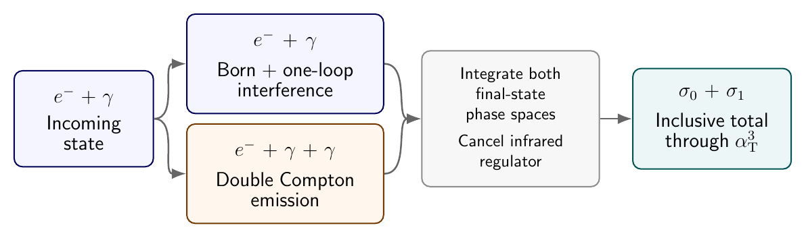

# Compton scattering at one loop: A detailed derivation

[Read the full derivation (PDF)](compton_calculation_details.pdf)

**An analytic result for this total cross section already exists. Roman N. Lee,
Matthew D. Schwartz and Xiaoyuan Zhang published it in Physical Review Letters 126,
211801 (2021), [The Compton Scattering Total Cross Section at Next-to-Leading
Order](https://doi.org/10.1103/PhysRevLett.126.211801). This work independently
recalculates and verifies their result.**

**This work was carried out by AI.** The calculation, analytic derivations
and verification were performed by GPT-6 Astra as the coordinating agent
and three GPT-6 Astra subagents, all using medium reasoning effort.
The work was subsequently reviewed using GPT-6 Astra and Claude Opus,
both with high reasoning effort.
Human involvement was limited to reviewing the document's presentation
and structure. The authors do not guarantee the
correctness of the content and accept no responsibility for errors.

## The problem

We calculate the total unpolarized Compton cross section for a photon
scattering on a free electron through next-to-leading order in QED.
The total combines the one-loop correction to electron–photon scattering
with double Compton scattering, whose final state contains an electron
and two photons. All allowed final-photon energies and directions are
integrated, with the electron mass kept exactly. Electron–positron pair
production is a separate process and is excluded.



The derivation starts from the Feynman rules, applies on-shell
renormalization, and performs the loop and phase-space integrations.
A photon mass regulates the infrared singularities. Its dependence
cancels when the virtual and real contributions are combined in the same
convention. Physical branches follow from the Feynman pole displacement
and the physical integration domain.

## The answer

For a photon of energy $\omega$ in the electron rest frame, define $X=2\omega/m=s_{\mathrm{phys}}/m^2-1>0$ and $Y=\sqrt{X/(X+4)}$. Here $m$ is the electron pole mass and $\alpha_{\mathrm T}$ is the Thomson coupling. The inclusive total through next-to-leading order is

```math
\boxed{\sigma_{\mathrm{inc}}^{\mathrm{NLO}}(X)
 =\frac{\pi\alpha_{\mathrm T}^2}{m^2}B(X)
  +\frac{\alpha_{\mathrm T}^3}{m^2}C_1(X)
  +\frac1{m^2}O(\alpha_{\mathrm T}^4).}
```

With $r_\omega=X/2$, the Born coefficient is

```math
\begin{aligned}
 B(X)=2\bigg[&\frac{1+r_\omega}{r_\omega^2}
 \left(\frac{2(1+r_\omega)}{1+2r_\omega}
       -\frac{\ln(1+2r_\omega)}{r_\omega}\right)\\
 &+\frac{\ln(1+2r_\omega)}{2r_\omega}
       -\frac{1+3r_\omega}{(1+2r_\omega)^2}\bigg].
 \end{aligned}
```

For an ordered list of letters $w$, with $\varnothing$ denoting the empty list, the iterated integrals use the following kernels:

```math
\begin{aligned}
G(a,w;X)&=\int_0^X\omega_a(t)G(w;t),\qquad G(\varnothing;X)=1,\\
 \omega_a&=\frac{\mathrm{d} X}{X-a}\quad(a=0,1,-1,-2,-4),\qquad
 \omega_r=\frac{\mathrm{d} X}{\sqrt{X(X+4)}}.
\end{aligned}
```

The symbol $r$ labels the positive square-root kernel. Pure-zero words have $G(0,\ldots,0;X)=\ln^nX/n!$ for $n$ zeros. The combinations containing the letter $1$ have removable singularities, with their continuous real values fixed in the derivation.

The ordinary polylogarithm is $\mathrm{Li}_n(z)=\sum_{k=1}^{\infty}z^k/k^n$ for $|z|<1$, continued on its principal branch elsewhere.

Define $L=\ln(1+X)$, $M=\ln X$ and $\zeta(3)=\sum_{k=1}^{\infty}k^{-3}$.

The paired function and its real representations are given below; the latter use polylogarithm arguments in $(0,1]$:

```math
\mathcal P(X)=G(0,-1,0;X)+G(0,1,0;X)=\tfrac12\left[\Re\mathrm{Li}_3(X^2)-M\Re\mathrm{Li}_2(X^2)\right].
```

```math
\mathcal P(X)=\tfrac12[\mathrm{Li}_3(X^2)-M\mathrm{Li}_2(X^2)],\qquad 0<X\leq1.
```

```math
\mathcal P(X)=\tfrac12[\mathrm{Li}_3(X^{-2})+M\mathrm{Li}_2(X^{-2})]+\tfrac13M^3+\tfrac16\pi^2M,\qquad X\geq1.
```

```math
R_{\log}(X)=\ln X/(X-1),\qquad X\ne1.
```

```math
R_{\log}(1)=1,\qquad R_{\log}(1+h)=1-\frac h2+\frac{h^2}{3}+O(h^3).
```

```math
C_1(X)=\frac{1}{X^3}\left[R_{\log}(X)+\mathcal E(X,L,M)+\sum_{j=1}^{13}b_j(X,Y,L,M)\mathcal F_j(X)\right].
```

The elementary logarithmic polynomial and its coefficients are:

```math
\mathcal E=e_{0}L^{3}+e_{1}L^{2}M+e_{2}L^{2}+e_{3}LM+e_{4}L+e_{5}M+e_{6}.
```

```math
e_{0}=- \frac{X^{2} - 16 X - 23}{3}.
```

```math
e_{1}=4 X^{2} - 2 X - 12.
```

```math
e_{2}=- 2 X^{3} - \frac{11 X^{2}}{2} + \frac{133 X}{2} + 36 + \frac{96}{X + 4} - \frac{6}{X + 1} + \frac{1}{\left(X + 1\right)^{2}}.
```

```math
e_{3}=X^{2} + 5 X - 10 + \frac{12}{X + 1} - \frac{4}{\left(X + 1\right)^{2}}.
```

```math
e_{4}=\frac{37 X^{2}}{4} - 32 X - 30 - \frac{15}{X + 1} - \frac{1}{\left(X + 1\right)^{2}}.
```

```math
e_{5}=- \frac{14 X^{5} + 31 X^{4} + 14 X^{3} - 6 X^{2} - 8 X - 2}{2 \left(X + 1\right)^{3}}.
```

```math
e_{6}=- \frac{X \left(273 X^{3} - 982 X^{2} - 2960 X - 1744\right)}{24 \left(X + 1\right)^{2}}.
```

The thirteen grouped functions and their coefficients are:

```math
\mathcal F_{1}=G(0,-1;X).
```

```math
b_{1}=X^{3} + X^{2} - 43 X + 6 - \frac{96}{X + 4} - \frac{6}{X + 1} + \frac{2}{\left(X + 1\right)^{2}}- 2 L X \left(2 X + 5\right).
```

```math
\mathcal F_{2}=G(-2,-1;X).
```

```math
b_{2}=- 4 X^{2} - 80 X - 68 - \frac{128}{X + 4} + \frac{8}{X + 1} - \frac{4}{\left(X + 1\right)^{2}}.
```

```math
\mathcal F_{3}=G(1,0;X),\qquad b_{3}=- X^{2} + X - 2.
```

```math
\mathcal F_{4}=G(r,-1;X).
```

```math
b_{4}=Y \left(3 X^{3} + 18 X^{2} + 44 X - 8 - \frac{64}{X}\right)- 3 M Y \left(X - 2\right) \left(X + 4\right).
```

```math
\mathcal F_{5}=G(0,-1,-1;X),\qquad b_{5}=- 5 X^{2} - 8 X + 32.
```

```math
\mathcal F_{6}=G(-1,-2,-1;X),\qquad b_{6}=8 \left(X^{2} - 4 X - 6\right).
```

```math
\mathcal F_{7}=G(-4,r,-1;X),\qquad b_{7}=Y \left(- 6 X^{2} + 72 + \frac{48}{X}\right).
```

```math
\mathcal F_{8}=\mathcal P(X),\qquad b_{8}=2 X^{2} + 4 X - 12.
```

```math
\mathcal F_{9}=G(r,0,-1;X),\qquad b_{9}=Y \left(- 5 X^{2} + 14 X + 88 + \frac{48}{X + 4} + \frac{48}{X}\right).
```

```math
\mathcal F_{10}=G(r,-1,0;X),\qquad b_{10}=- 3 Y \left(X - 2\right) \left(X + 4\right).
```

```math
\mathcal F_{11}=G(r,-1,-1;X),\qquad b_{11}=Y \left(15 X^{2} - 18 X - 216 - \frac{96}{X + 4} - \frac{96}{X}\right).
```

```math
\mathcal F_{12}=G(r,-2,-1;X),\qquad b_{12}=Y \left(- 16 X^{2} + 32 X + 256 + \frac{64}{X + 4} + \frac{192}{X}\right).
```

```math
\mathcal F_{13}=G(r,r,-1;X),\qquad b_{13}=9 X^{2} - 24.
```

The shuffle identities and the analytic derivative and boundary arguments in [the derivation](tex/total_energy_compact_formula.tex) establish this form, including its real continuation through $X=1$. Expanding the products recovers the original twenty-three coefficients exactly.

## Simplification of our result

Our independently derived result is written in a different form from the published expression of Lee, Schwartz and Zhang, but the two are analytically equivalent.

## Results and verification

The total is fully integrated analytically, with low- and high-energy expansions. All 23 coefficient differences against the published result vanish, and independent numerical integration agrees at seven energies within estimated errors; Chapter 7 gives the checks and their limits.

## Compilation

With `latexmk` and TeX (including TikZ/PGFPlots), run `make` to build `build/compton_calculation_details.pdf`.

## Checks and evaluation

```sh
python3 -m venv .venv
. .venv/bin/activate
python -m pip install -r requirements.txt
make check PYTHON=python
python scripts/compton_total_independent_closed.py --s 1.6 --dps 35
```

The suite runs 9 preparation steps and 47 checks, with logs in `build/checks/`; expensive phase-space audits are separate, with saved results in `reports/`.
Here `--s` is $s_{\mathrm{phys}}/m^2=1+X$, and the output `total` is $C_1(X)$: multiply by $\alpha_{\mathrm T}^3/m^2$ and add the Born term.
